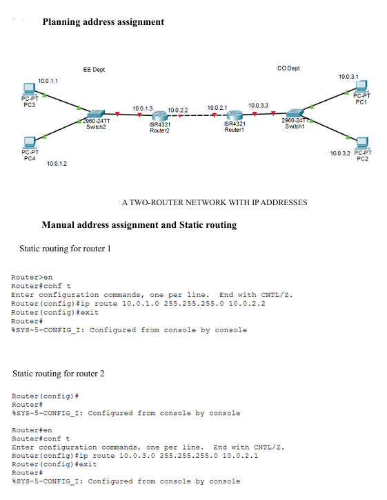
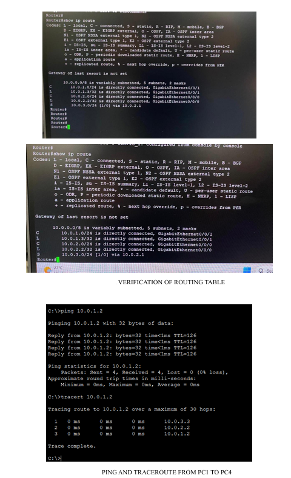

IPv4 Addressing, Static Routing and RIPv2

**Tool:** Cisco Packet Tracer

This compares static and dynamic routing in a two-router network. I
assigned IPv4 addresses and default gateways, configured static routes,
then replaced those routes with RIPv2 to compare how each configuration
reaches remote subnets.

## Packet Tracer simulations

| Simulation | Configuration |
| --- | --- |
| [Manual Address Assignment and Static Routing](./ManualAddressAssignmentAndStaticRouting.pkt) | IPv4 addressing and manually configured routes |
| [Dynamic Routing with RIPv2](./DynamicRoutingRIP.pkt) | Dynamic exchange of routing information between the two routers |

## Network topology

## Static routing verification

I inspected the router's routing table and ran ping tests from PC1.

- [Static routing table](./RoutingtableStaticRouting.png)
- [PC1 → PC2 ping test](./Static_PingPC1_PC2.png)
- [PC1 → PC3 ping test](./Static_PingPC1_PC3.png)

## RIPv2 verification

After enabling RIPv2, I inspected the routing table for routes marked `R`,
which indicates they were learned through RIP. I then tested end-to-end
connectivity by pinging PC4 from PC1 across the two-router network.

[View the RIP routing table](./Dynamic_RoutingTable.png)

