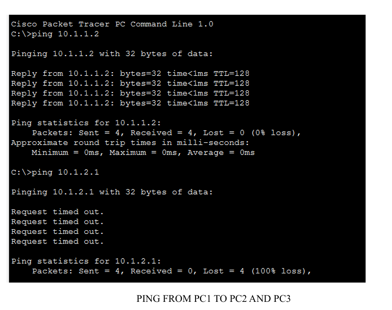
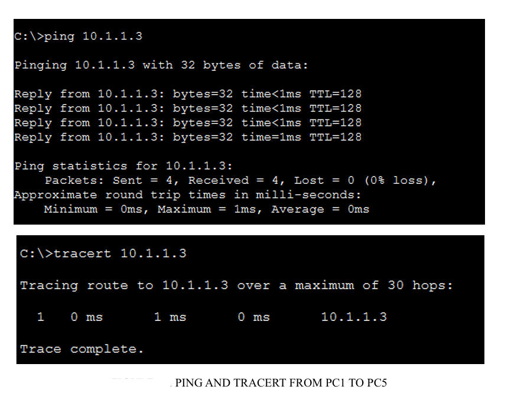
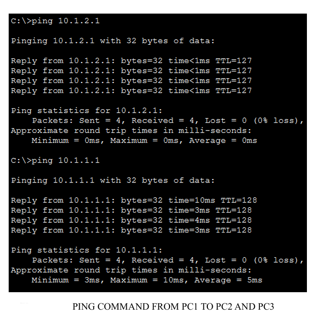

1. IPv4 Addressing, Static Routing and RIPv2

**Tool:** Cisco Packet Tracer

This compares static and dynamic routing in a two-router network. I
assigned IPv4 addresses and default gateways, configured static routes,
then replaced those routes with RIPv2 to compare how each configuration
reaches remote subnets.

## Packet Tracer simulations

| Simulation | Configuration |
| --- | --- |
| [Manual Address Assignment and Static Routing](./ManualAddressAssignmentAndStaticRouting.pkt) | IPv4 addressing and manually configured routes |
| [Dynamic Routing with RIPv2](./DynamicRoutingRIP.pkt) | Dynamic exchange of routing information between the two routers |

## Network topology

## Static routing verification

I inspected the router's routing table and ran ping tests from PC1.

- [Static routing table](./RoutingtableStaticRouting.png)
- [PC1 → PC2 ping test](./Static_PingPC1_PC2.png)
- [PC1 → PC3 ping test](./Static_PingPC1_PC3.png)

## RIPv2 verification

After enabling RIPv2, I inspected the routing table for routes marked `R`,
which indicates they were learned through RIP. I then tested end-to-end
connectivity by pinging PC4 from PC1 across the two-router network.

[View the RIP routing table](./Dynamic_RoutingTable.png)

2. VLAN Segmentation and Inter-VLAN Routing

I configured VLANs on one and two switches, then used IEEE 802.1Q
router subinterfaces to enable communication between VLANs. I used
`ping` and `tracert` to test connectivity before and after routing
was configured.

| VLAN | IPv4 subnet |
| --- | --- |
| VLAN 10 | `10.1.1.0/24` |
| VLAN 20 | `10.1.2.0/24` |

## Packet Tracer simulations

| Part | Simulation | What it demonstrates |
| --- | --- | --- |
| 2 | [Single-switch VLANs](./singleSwitchVLAN.pkt) | Same-VLAN connectivity and isolation between VLANs |
| 3 | [Two-switch VLANs](./TwoSwitchVLAN.pkt) | Same-VLAN connectivity across two switches |
| 4 | [Inter-VLAN routing](./interVLANRouting.pkt) | Communication between VLANs through router subinterfaces |

## Verification results

VLAN isolation on one switch

PC1 (`10.1.1.1`) reached PC3 (`10.1.1.2`) in VLAN 10.
The ping to PC2 (`10.1.2.1`) in VLAN 20 failed before inter-VLAN
routing was configured.

Same-VLAN connectivity across two switches

PC1 reached PC5 in VLAN 10 across the link between the two switches.

Inter-VLAN routing with 802.1Q

I configured router subinterfaces as default gateways for VLANs 10
and 20. PC1 then successfully reached PC2 in VLAN 20.

